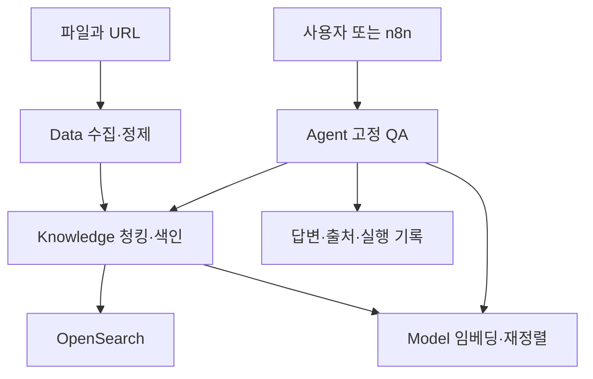
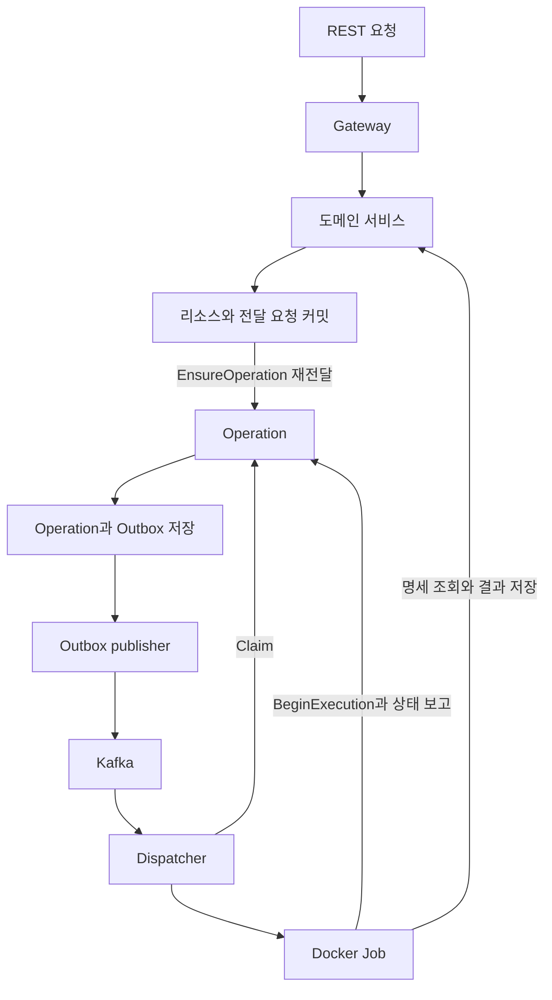

# 구조와 요청 경로

자동화·적응성과 플랫폼 독립성을 [공통 설계 원칙](design-principles.md)으로 유지한다. 현재 지원 우선순위는 단일 노드 Docker다. 상태와 인수 여부는 [status](status.md)에서 관리하며 이 문서는 코드의 책임/호출 경계를 설명한다.

## 플랫폼 경계

| 소유자 | 자산과 처리 | 외부 의존 |
|---|---|---|
| Model | 모델/버전·학습·배포·추론 | PostgreSQL·MinIO·Kafka·MLflow·Docker/GPU |
| Data | 원본·자료 그룹·정제·canonical | 수집 대상, Model OCR 배포, 자체 DB/객체/실행 경로 |
| Knowledge | 청커·청크·인덱스/버전·검색 | Data canonical, Model embedding/reranker, OpenSearch |
| Agent | Connection·Tool·MCP·Agent/실행 기록 | Model/Knowledge 공식 API |
| Ops | 통합 조회·자원/추적/경보 표시 | 4개 업무 플랫폼과 Prometheus/Langfuse/Alertmanager API |
| infra/n8n | 인프라 기동·상위 업무 흐름 | Agent/Tool API 호출 |

## 채택한 확장의 목표 경계

2026-10-12 [확장 계획](plans/platform-expansion-work-plan-20261012.md)을 채택했다. 위 표는 현재 구현이며 아래는 F1 이후 목표다. 현재 Dataset/Version은 여전히 Model Training이 관리한다.

| 추가/이전 영역 | 목표 책임 |
|---|---|
| 학습데이터·가공/레시피·버전·split·export | Data. 기존 Model 데이터셋은 API/export·mapping·readback으로 점진 이전 |
| 학습·checkpoint·평가 실행·모델 결과·외부 provider 추론 | Model. Data 불변 입력 pin·legacy 학습/키·로컬 배포 계약 유지 |
| 일정/DAG | Data가 schedule/구간 정책, infra가 Airflow 기동. n8n의 기존 상위 Flow와 일정 소유자 분리 |
| 세션/turn·기억·기본/문서 Tool | Agent. Data가 문서/template/artifact 버전·계보 관리 |
| LightRAG/그래프/선택 Neo4j | Knowledge의 격리 평가 adapter와 infra 저장소. Data 파싱·Model 추론·Agent 최종 답변 경계 유지 |

선택 서비스는 기존 플랫폼의 대체 DB/상태 원본이 아니다. 이 문서는 이전/설치 완료를 선언하지 않으며 외부 API backend와 local GPU runtime을 구분하는 계약은 해당 단계에서 확정한다.

## 문서 검색과 답변 경로

자연어 질의의 query embedding은 Agent Tool이 Model API로 얻고 Knowledge에는 벡터·임베딩 공간·인덱스 버전을 전달한다. Knowledge가 optional rerank를 수행하고 Agent는 Model chat 응답의 인용 형식을 검사한다. 형식 검사는 의미 품질 보증과 다르다. OCR은 배포된 Model의 endpoint를 조회한 뒤 Data에서 호출하는 경로다.

LangGraph는 현재 `knowledge_qa_v1`의 다섯 고정 단계를 실행한다. n8n은 상위 Flow 편집/호출 도구이며 Agent의 workflow link는 해당 흐름과 버전을 연결한다. LiteLLM 자동 등록·BM25/RRF·임의 Agent 그래프는 이 코드의 현재 기능이 아니다.

## 관측과 운영 제어

Ops web은 공식 조회 API/관측 결과만 읽으며 Docker socket을 마운트하지 않는다. 환경 발견·worker·백업/복구는 host 운영 도구에서 별도 계약으로 처리한다. 현재 관측 백업 범위는 업무 플랫폼 전체 복구와 다르다. [Ops](ops-platform/README.md), [백업 경계](operations/backup-restore.md)를 참고한다.

Data·Knowledge·Agent의 상세 계약은 각 [Data 구조](data-platform/architecture.md), [Knowledge 구조](knowledge-platform/architecture.md), [Agent 구조](agent-platform/architecture.md)에 둔다. 아래는 Model 서비스 세부 구조다.

## Model 서비스와 데이터 소유권

| 구성 | 책임 | 위치 / DB |
|---|---|---|
| Gateway | 외부 REST와 내부 gRPC 변환, ready 배포 채팅 전달 | [gateway](../model_platform/gateway/) |
| Playground | 모델 관리·데이터셋·학습·배포·별도 채팅 UI, 선택적 profile | [playground](../model_platform/playground/) |
| Management | 모델, 버전, import credential, 결과물 검증 | [management](../model_platform/management/) / `model_management` |
| Training | 학습 요청·결과·MLflow 연결, 로컬 학습 취소·로그 조회 | [training](../model_platform/training/) / `model_training` |
| Deployment | 배포 요청, demo 결과, 실제 서빙 생성·관찰·중지 | [deployment](../model_platform/deployment/) / `model_deployment` |
| Operation | 실행 상태, Outbox, Claim·실행 승인·복구 | [operation](../model_platform/operation/) / `model_operations` |
| Dispatcher | Kafka 소비, DB 기준 routing, Executor 호출 | [dispatcher](../model_platform/dispatcher/) |
| Reconciler | 도메인·Docker 관찰과 실행 전 lease 복구 요청 | [reconciler](../model_platform/reconciler/) |
| GC | 종료 Job 로그 보존·검증과 보존 기간 후 컨테이너 제거 | [gc](../model_platform/gc/) / 별도 `model-job-logs` 버킷 |
| Job | 시작 승인 후 도메인 정보 조회와 실제 작업 | [jobs](../model_platform/jobs/) |

각 서비스가 자기 DB의 메타데이터를 소유한다. 정상 애플리케이션 경로는 다른 서비스 DB를 직접 변경하지 않고 gRPC를 사용한다. Reconciler도 Operation에 관찰 결과를 전달하며 상태 쓰기는 Operation이 수행한다.

도메인 리소스·키 재현 응답·Operation 전달 요청은 도메인의 로컬 트랜잭션이다. Operation과 Outbox는 별도의 로컬 트랜잭션이다. 사이의 gRPC 응답이 유실돼도 도메인 worker가 예약된 같은 ID로 재전달한다. Kafka 발행은 Operation의 Outbox worker가 맡는다. [생성 요청 계약](reference/request-creation.md)에 이 경계와 202 응답의 의미를 정리했다.

## 실행 종류

| execution_type | resource_id | 동작 |
|---|---|---|
| `management.import-huggingface` | model_version_id | HF 파일을 내려받아 MinIO snapshot 등록 |
| `training.run` | training_run_id | MinIO 입력 → Axolotl → MLflow·MinIO·Management 결과 등록 |
| `deployment.apply` | deployment_id | CPU demo 완료 처리 |
| `deployment.serve` | deployment_id | 승인 후 실제 vLLM 준비 요청·결과 보고. GPU는 별도 서빙 컨테이너가 사용 |

Dispatcher는 Job 이미지와 실행 위치를 결정한다. DatasetSpec, TrainingSpec, HF token 같은 도메인 상세는 Job이 해당 서비스에 조회한다. Registry와 Executor 경계는 [개발 안내](development.md), 전달·복구 규칙은 [실행 프로토콜](reference/execution-protocol.md)을 참조한다.

## 외부 REST

현재 로컬 설치의 기본 예시는 `http://127.0.0.1:13000`이며 실제 경로는 [routes.go](../model_platform/gateway/app/routes.go)에 있다.

| Method | 경로 | 용도 |
|---|---|---|
| GET | `/health` | Gateway 자체 응답 확인 |
| POST | `/api/models` | 모델 생성 |
| GET | `/api/models/:id` | 모델 조회 |
| POST | `/api/models/:id/imports/huggingface` | 모델 버전 import 요청 |
| GET | `/api/model-versions/:id` | 모델 버전·artifact 조회 |
| GET | `/api/operations/:id` | 실행 상태·오류 조회 |
| POST | `/api/training-runs` | 학습 요청 |
| GET | `/api/training-runs/:id` | 학습 결과·추적 정보 조회 |
| POST | `/api/training-runs/:id/cancel` | 로컬 학습 취소 요청, 실제 중지 뒤 cancelled 확정 |
| GET | `/api/training-runs/:id/logs` | 현재 Job 또는 검증된 보관 로그의 stdout/stderr 조회 |
| POST | `/api/deployments` | demo 또는 명시적 vLLM 배포 요청 |
| GET | `/api/deployments/:id` | 배포 결과 조회 |
| POST | `/api/deployments/:id/stop` | 실제 서빙 중지 의도 저장, 202 뒤 stopped 확인 |
| POST | `/api/deployments/:id/chat` | 준비된 로컬 vLLM 채팅, 새 Operation/Job 없음 |

`/health` 성공은 DB·Kafka·Job 경로 전체가 정상이라는 뜻이 아니다. 전체 제어 경로는 [smoke](testing/request-creation.md#control-smoke)로 확인한다.

## 실제 서빙 수명주기

`deployment.serve` Job은 CPU에서 실행 승인을 받고 Deployment에 StartServing을 요청한다. Deployment controller가 MinIO snapshot을 검증·준비하고 GPU vLLM 컨테이너를 생성한다. adapter 요청은 정확한 base snapshot과 검증된 LoRA 서빙용 사본을 함께 로드하며 [adapter 계약](reference/adapter-serving.md)을 따른다. health·모델명 확인 뒤 준비 결과를 확정하면 Job은 Operation에 보고하고 종료한다. vLLM은 명시적 중지까지 계속 실행한다. 준비 결과 apply_status와 런타임 상태를 분리하므로 이후 중지가 과거 성공 Operation을 바꾸지 않는다. [서빙 계약](reference/serving.md)에 API·오류·소유권·캐시 정책을 정리했다.

## Import credential

비공개·gated repository의 HF token은 import 요청으로 전달한다. Management가 AES-256-GCM으로 암호화해 임시 저장하고 Job이 gRPC로 가져온다. 성공·실패 시 삭제하며 TTL은 1시간이고 Management 시작 시 만료 행을 청소한다. Kafka, Operation, Docker 환경 변수·label, API 응답에는 HF token을 포함하지 않는다. 내부 gRPC transport는 현재 insecure다.

## 로컬 다중 GPU 확장

Training은 GPU IDs와 DDP strategy를 고정하고 하나의 Docker Job 안에서 rank별 학습 프로세스를 실행한다. Dispatcher와 Deployment controller가 같은 로컬 GPU 점유 볼륨을 사용해 생성·시작을 조율한다. Training 취소 controller도 이 볼륨에 영속 생성 차단 기록을 저장하고 실제 중지 뒤 예약을 해제한다. 별도 상시 서비스는 추가하지 않는다. [학습 제어 계약](reference/training-control.md), [다중 GPU 계약](reference/multi-gpu.md), 서버 검증 상태는 [현재 상태](status.md)를 따른다.

## 원격 노드 실행

중앙 Dispatcher의 Router가 `node_name`에 따라 로컬 Docker 또는 SSH worker를 선택한다. 원격 worker도 동일한 실행 gate·GPU admission을 사용하며, Reconciler는 지정한 호스트의 컨테이너를 관찰한다. 기본 Compose는 기존 로컬 실행이고 원격 연결은 별도 override로 활성화한다. 첫 범위는 amd64 단일 GPU 학습이다. [원격 노드 계약](reference/remote-nodes.md)과 [설치·검증](testing/remote-nodes.md)을 따른다.

## 조회·검색과 체험 페이지

모델·모델 버전·학습·배포·Operation의 목록·검색은 Gateway REST에서 각 도메인의 gRPC 조회로 연결한다. 한 요청은 도메인 DB의 단일 목록 SELECT로 처리하며, 작업을 생성하거나 다른 도메인을 항목별로 호출하지 않는다. [목록 계약](reference/catalog.md)에 필터·커서·요약 필드를 정의했다.

최종 사용자 화면은 별도 Streamlit Playground로 구현했다. 모델 관리·데이터셋·학습 작업·배포 관리·채팅으로 나누며, 사용자는 조회 버튼으로 모델 목록을 불러오고 이름·버전을 선택해 등록·가져오기·학습·배포를 직접 실행한다. 학습의 로그·취소·평가·재개·출력 복구도 기존 API로 연결한다. 채팅은 이미 배포된 모델을 선택하는 별도 화면이다. 화면은 Gateway REST를 사용하며 DB·Docker를 직접 제어하지 않는다. 채팅은 Gateway가 Deployment gRPC로 ready 실행을 확인하고 내부 Docker 네트워크의 vLLM에 전달한다. 시작/중지는 기존 제어 경로를 사용하고 새로고침은 조회만 수행한다. [관리 화면 계약](reference/streamlit-playground.md), [서버 적용·검증](testing/streamlit-playground.md)을 따른다. Kubernetes와 원격 노드 적용은 보류하고 단일 서버 API 기능과 체험 페이지를 먼저 완성한다.

A04 구현에서도 명세·Tool 버전·실행 기록은 Agent DB에 두고 외부 기능은 HTTP 공개 API로만 호출한다. [현재 OpenAPI/HTTP 경계](agent-platform/openapi-foundation.md)를 따른다.
