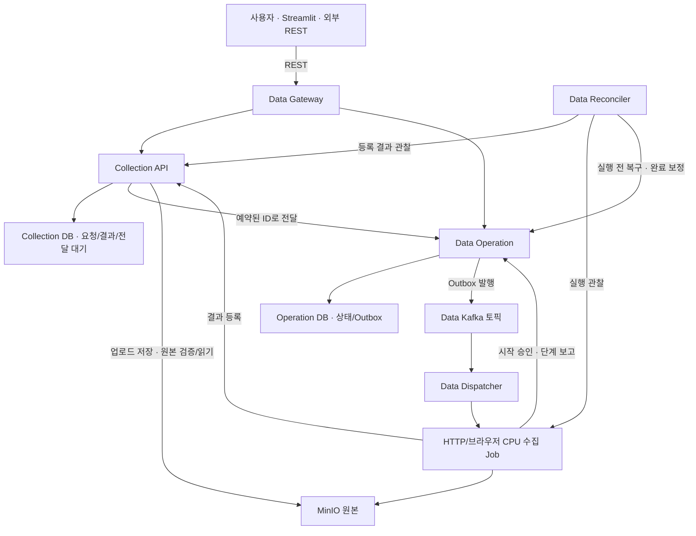

# Data Platform 구현 경계

Data의 설치·연결·수집/정제 설정에도 [자동화와 적응성](../design-principles.md)을 적용한다. 기존 설정과 Model API의 기능/배포 후보를 재사용하고, 사용자가 주소·배포 정보를 중복 입력하는 흐름을 줄이는 방향으로 확장한다. 원본/canonical 소유권과 고정한 OCR 실행 식별자·품질 표시는 유지한다. 아래 구현 경로를 자동 발견 완료로 해석하지 않는다.

2026-09-15. 수집·업로드·CPU 정제와 Surya 연결의 서버 기능 검증을 완료했다. 수정 후 HF import·GPU 배포·PNG/스캔 PDF 실제 OCR이 PASS했다. [결과·검증 범위](../history/data-platform-202609.md#2026-09-15-02-ocr-verified).

## 소유권

| 요소 | 실제 이름 | 소유 정보 |
|---|---|---|
| 수집 DB | `data_collection` | crawl_runs, source_documents, api_requests, operation_submissions |
| 정제 DB | `data_refinement` | refinement_runs, canonical_documents와 정제 요청·전달 대기 |
| 정제 버킷 | `data-canonical` | 검증된 공통 JSON과 원본/처리 출처 |
| 실행 DB | `data_operations` | operations, operation_outbox |
| Kafka | `data.operations.requested` / `data-platform-dispatchers` | 데이터 작업 요청 전달 |
| 원본 버킷 | `data-sources` | 수집 `sources/{crawl_run_id}/sha256/{hash}/original`, 업로드 `uploads/{key_hash}/sha256/{hash}/original` |
| Gateway | `data-gateway`, 기본 `127.0.0.1:14000` | REST 입력과 공개 상태/파일 응답 |
| 실행 컨테이너 | `data-op-{operation_id}-{dispatch_token}` | 하나의 시작 승인에 대응하는 CPU Job |

PostgreSQL·MinIO·Kafka 서버와 Docker 네트워크는 기존 `ops-infra`를 공유한다. 모델의 DB·버킷·토픽·consumer group은 재사용하지 않는다. Data gRPC 패키지는 `data.operation.v1`, `data.collection.v1`, `data.refinement.v1`이며, Compose 서비스 이름도 `data-` 접두사로 구분한다. 도메인끼리 상대 DB를 직접 읽지 않는다.

## 완료와 불확실한 결과

Collection의 원본 파일 검증과 결과 메타데이터 등록이 먼저다. 그 이후 Job이 Operation을 성공으로 보고한다. 성공 보고가 유실되면 Reconciler가 이미 등록된 원본 문서를 확인하여 완료 상태를 보정한다.

시작 승인을 받기 전의 120초 lease가 만료되면 기존 토큰을 취소하고 같은 Operation의 Outbox를 다시 준비한다. 시작 준비는 최대 3세대까지다. 실제 시작 승인 이후에는 자동 재수집하지 않는다. 이미지 조회·실행 설정 검사 실패처럼 Docker 생성 전임이 확실한 오류만 `LAUNCH_REJECTED`로 확정한다. Docker CLI의 타임아웃은 생성 실패의 증거로 취급하지 않는다.

프로세스가 종료됐지만 결과 등록 여부까지 확인할 수 없는 경우에는 수동 확인 대상으로 남기고 Reconciler 로그에 이유를 기록한다. 종료 사실만으로 늦게 도착하는 결과 등록을 실패로 덮어쓰지 않는다. 이번 단계에는 수동 복구 API, 실행 중 취소, 로그 보관·삭제·GC API가 없다. 실제 HTTP 실패와 저장 실패는 Job이 오류 코드로 보고하며, 중지된 Job 로그와 등록되지 않은 잔여 원본은 보존한다.

두 서비스 DB와 MinIO 전체를 하나의 트랜잭션으로 묶었다고 주장하지 않는다. 요청 전달, 결과 등록, 상태 보고 각각을 동일 ID·동일 결과로 반복할 수 있게 하고, 실제 다운로드의 자동 반복과 구분한다.

## HTTP 수집과 결과 보존

DNS에서 얻은 주소를 모두 검사한 후 그중 검사한 IP에 직접 연결한다. 리다이렉트에도 같은 검사를 적용한다. 환경의 HTTP proxy는 사용하지 않는다. URL을 내려받는 클라이언트와 내부 MinIO·gRPC 연결은 별도다.

요청 `max_bytes`를 헤더와 실제 읽은 바이트 양 모두에 적용한다. 선언된 길이보다 짧은 응답, 206 부분 응답, HTTP 오류는 성공 원본으로 등록하지 않는다. 다운로드한 바이트는 정제하지 않는다. 등록 시 실제 저장 객체를 읽어 SHA-256과 크기를 검증하고, 다운로드 API에서도 무결성을 확인한다.

원본의 `document_id` 자체가 고정된 버전 ID다. 동일 URL을 새 키로 다시 수집하면 새 버전이 생긴다. 원본을 in-place 교체하는 API는 없다. 독립된 정제 실행은 이 ID를 입력으로 고정한다.

## 현재 구현과 확장 경계

- 업로드: Collection 내부 동기 원본 등록으로 구현. [업로드 API 계약](api-upload.md)에 따라 같은 문서 버전 ID를 이후 정제 입력으로 사용한다.
- 정제: 상시 Go API + CPU one-shot 처리 Job. HTML/PDF/TXT/MD/이미지/DOCX/XLSX를 공통 문서 JSON으로 변환한다.
- 규칙: 공백·문자 정규화·HTML 잔여 요소 정리는 정제의 기본 cleaning으로 구현한다. 구조·코드 들여쓰기·표 셀·수식을 보존하고 규칙 버전과 적용 이력을 기록한다. 독립적인 보강 서비스는 필요가 확인될 때 분리한다. LLM 보강은 넣지 않는다.
- OCR: 이미 Model Platform에 배포된 Surya v2에 이미지 추론을 요청한다. 별도 GPU 모델을 CPU Job에서 자동 실행하지 않는다. 현 Model Gateway의 텍스트 채팅 경로만으로 OCR 연동이 완료된 것으로 처리하지 않는다.
- OCR 품질: 페이지/블록 텍스트 품질, 이미지 영역, 표·읽기 순서 누락으로 fallback을 판단한다. 파일 크기 대비 문자량은 보조 지표다. 표·병합 셀·좌표 기준·읽기 순서를 모두 검증하고 누락을 숨기지 않는다.
- UI: 모델 플랫폼의 목록·행별 버튼·팝업·진행 표시를 참조한다. 수집/업로드 → 원본 선택 → 정제 → 결과 확인을 직접 수행한다.
- Airflow(후속): Gateway 요청 제출 → Operation 대기 → 원본/정제 버전 ID를 후속 작업에 전달. 같은 논리 호출의 전송 재시도에는 같은 멱등 키를 사용하고, 다음 스케줄 회차에는 새 키를 쓴다. 본문을 XCom에 넣지 않는다.
- Kubernetes, 원격 노드, 멀티 노드: 현재 Docker 단일 노드 경로와 UI를 완성한 뒤 별도 전환한다.

이번 HTTP 수집 Job은 Go로 구현했다. 브라우저 수집은 Go Job과 격리된 Python/Chromium을, 문서 파싱·Surya 요청은 Go 정제 Job과 격리 Python CLI를 사용한다. 재현에 필요한 Go 모듈과 생성 protobuf는 Docker builder 내부에 만든다.

## 동기 업로드의 완료 경계

Gateway가 크기 제한 안에서 multipart 전체를 받은 뒤, 메타데이터와 64 KiB 이하 청크를 Collection gRPC 스트림에 전달한다. 두 서비스는 각각 업로드 2개로 동시 버퍼링을 제한한다. multipart 파일의 선언 MIME은 형식 판단에 사용하지 않는다.

Collection이 전체 크기·해시·형식을 확인한 다음 멱등 키 트랜잭션을 연다. 같은 키의 요청은 DB에서 직렬화되며, 저장·읽기 검증이 끝나야 원본 행과 재전송 응답을 커밋한다. 일반 요청의 기존 15초 트랜잭션 제한은 유지하고 업로드만 최대 90초를 사용한다.

MinIO와 DB 사이에 원자적 커밋은 없다. 저장 후 DB 실패 시 등록되지 않은 객체가 남을 수 있으므로 요청 키의 SHA-256과 내용 SHA-256으로 객체 키를 고정한다. 같은 요청 재시도는 같은 객체 키를 사용한다. 등록된 원본을 교체하는 API나 자동 객체 삭제는 추가하지 않았다.

기존 원본은 `source_type=crawl`로 유지하고 URL·Job·객체 키를 보존한다. 업로드 원본은 `crawl_run_id`를 NULL로 저장하고 공개 응답은 빈 문자열로 보낸다. 다운로드는 저장된 `object_key`를 사용하므로 두 출처 모두 같은 API를 거친다. 스키마 확장 후 업로드 행이 있는 DB를 이전 Collection 이미지로 읽는 롤백은 지원하지 않는다.

## 정제 도메인 확장

Gateway → Refinement gRPC → data_refinement 요청/전달 대기 → 기존 Data Operation/Outbox/Kafka → refinement.parse CPU Job으로 연결한다. Job은 Collection gRPC로 원본을 읽고, data-canonical에 결과를 저장한 뒤 Refinement에 등록한다. Reconciler는 정제 결과 등록도 관찰한다. [세부 계약](api-refinement.md). 위 수집 경로 그림과 수집 소유권은 그대로 유지한다.

## 선택적 OCR 연결

Refinement는 새 요청에 지정된 `ocr_deployment_id`를 Model Deployment의 읽기 전용 gRPC로 확인하여 모델 버전·manifest·실제 runtime 식별자를 고정한다. 승인된 CPU Job이 이를 다시 확인하고 선택된 PNG/JPEG/PDF 페이지를 vLLM의 이미지 HTTP 계약으로 전송한다. Model은 기존 GPU 승인·controller로 Surya 전용 profile을 관리한다. Data가 Model DB를 읽거나 모델을 자동 기동하지 않는다.

완료 등록은 고정한 모델 식별·OCR processor 버전·페이지 상태·미완료 품질 표시를 검증한다. 원본과 CPU 추출을 보존하고 생성 결과를 검토 대상으로 남긴다. [계약·좌표·한도](api-ocr.md), [서버 검사](testing-ocr.md).

## HTTP 확장 수집

같은 `collection.crawl` Operation/실행 승인을 사용한다. 확장 원본 키는 `sources/{crawl_run_id}/urls/{요청_URL_SHA256}/sha256/{원본_SHA256}/original`이다. 동일 바이트라도 요청 URL이 다르면 출처별로 저장한다. 기존 단일 URL 키와 업로드 키는 유지한다.

Collection은 전체 manifest의 범위·부모·깊이·바이트 상한과 저장 객체 무결성을 검사한 뒤 모든 원본 ID와 결과 배열을 한 트랜잭션으로 등록한다. Reconciler는 배열의 모든 원본 상태와 처리기 일치를 관찰한다. HTTP Job은 한 파일씩 저장해 임시 디스크를 제한한다. 상세 제한은 [수집 확장 가이드](testing-collection-scope.md)에 있다.

## 기존 코드 재사용과 독립 범위

모델 플랫폼 v1 소스에서 다음 부분을 골라 가져왔다. 원본 경로와 읽은 시점의 SHA-256은 `src/platform/data/reuse-manifest.json`에 있다. 수정 후 파일의 해시라는 뜻이 아니다.

- Operation 생성·시작 승인·lifecycle·Outbox·재조정 CAS와 관련 테스트
- 요청 멱등 처리, 도메인 전달 worker, 페이지네이션, DB bootstrap, gRPC serve, Job 상태 보고
- Dispatcher의 claim·전달·commit 처리

import module을 `data-platform`으로 바꾸고 gRPC package, DB, 토픽, 서비스 이름을 분리했다. CPU 수집 전용 실행 profile과 시작 전 scope 검사를 추가했다. GPU admission, 학습 취소, adapter 준비, 원격 노드 라우터, 모델 카탈로그와 서빙 제어기는 가져오지 않았다.

재사용한 Operation schema/protobuf에는 원본 실행 계약의 일부 미사용 필드가 남아 있다. 초기 수집 구현은 CPU collection.crawl만 허용했다. 이후 정제 실행이 추가됐으며 현재 실행 범위는 이 아키텍처와 정제 API 계약을 따른다. 공통 라이브러리를 두 실행 프로젝트가 동적으로 공유하도록 바꾸지는 않았으며, 검증된 코드의 제한된 사본을 사용한다. 모델 플랫폼의 실행 중인 서버에는 이 변경을 적용하지 않는다. 향후 공통 패키지 추출 시 두 플랫폼의 실행 승인·결과 보고 회귀 테스트를 함께 실행해야 한다.

프로토타입에서는 네트워크·리다이렉트 정책과 수집기 분리 방향을 참조했다. 도메인 전용 보강, 기존 pipeline 추적 구조, 브라우저 worker 전체를 복사하지 않았다. 이번 단일 HTTP 수집기는 Go로 새로 구현했으며 DNS 검사와 실제 연결 주소가 같도록 만들었다.

Gateway도 `gateway/app`의 REST → 내부 gRPC 구성은 유지한다. 첫 Data REST handler는 Go 표준 `net/http`로 구현하여 HTTP 프레임워크 의존성을 추가하지 않았다. 정제·OCR Job과 UI의 구현 언어를 이것으로 제한하지 않는다.
