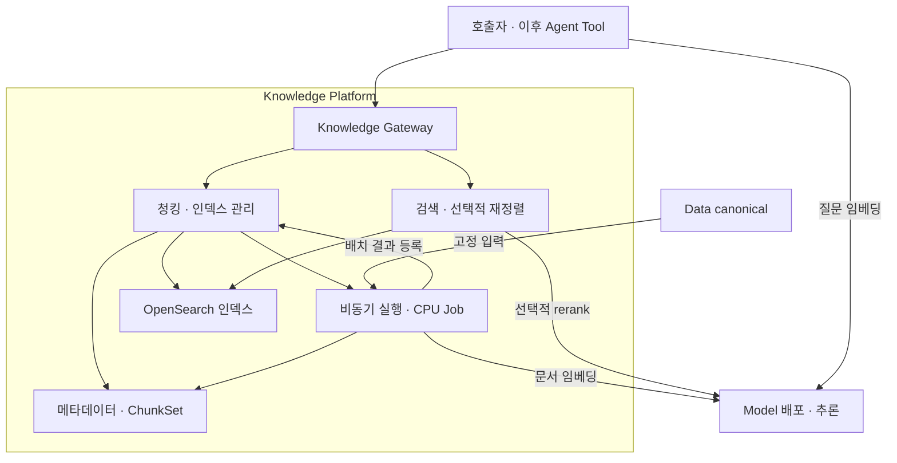

# Knowledge Platform 아키텍처

Knowledge에도 [자동화와 적응성](../design-principles.md)을 적용한다. 소유 플랫폼 API에서 호환 가능한 자료·모델 기능을 발견하고 필요한 선택과 연결 설정을 줄이는 방향으로 확장한다. 확정한 canonical·인덱스 버전·임베딩 공간·rerank 계약과 플랫폼 독립성은 유지한다. 자동 발견/갱신은 아래 현재 구현과 구분하는 후속 범위다.

갱신일: 2026-09-22. 이 문서는 현재 구현의 책임 경계와 구성을 설명한다. 정확한 요청 필드·한도·오류는 [청킹](api-chunking.md), [색인](api-indexing.md), [검색](api-search.md), [선택적 rerank](api-search.md#rerank) 계약을 따른다. v1 핵심 구현·사용자 서버 확인은 [작업 목록](work-plan.md)과 [화면](console-ux-20260922.md), [실패·복구](testing-failure-recovery-20260922.md) 기록을 기준으로 한다.

K08은 서비스 밖의 [평가 도구](evaluation.md)다. 고정 canonical의 source/block/range 정답과 동일 질문 벡터를 사용해 청커·rerank 옵션을 비교한다. [실제 12문항 비교](acceptance.md#k08)는 확인했으나 품질 일반화를 뜻하지 않는다. recursive 최초 후보 불일치 원인은 미확정이며 실패 보고서를 유지한다.

**Knowledge는 문서를 검색 가능한 청크와 인덱스로 만들고, 질문 벡터에 대한 검색 결과를 선택적으로 재정렬해 반환하는 플랫폼이다.** Model은 모델 배포·추론을, Agent는 MCP·Tool·Agent flow 관리를 담당한다. Knowledge의 독립성은 자체 데이터·수명주기·검색 정책을 소유하는 데서 나온다.

## 1. 책임과 범위

| 기능 | 소유자 | 플랫폼 간 계약 |
|---|---|---|
| 원본 수집·업로드·parsing/OCR·문서 구조 판별·canonical | Data | Knowledge는 확정한 canonical 버전의 블록 유형·출처·품질을 읽는다. |
| 청커 선택·옵션·청크 생성·미리보기 | Knowledge | 모델 없이 실행 가능한 CPU 작업이다. |
| embedding/reranker 배포·로드·추론·상태 | Model | Knowledge와 호출자는 준비된 배포를 명시해 요청한다. |
| 문서 청크 임베딩 요청·결과 검증 | Knowledge | 문서 역할로 Model embedding을 호출한다. |
| 색인·버전·활성화·자료 제외·삭제 | Knowledge | Knowledge의 메타데이터와 검색 저장소를 관리한다. |
| 질문 임베딩 요청 | 호출자, 추론은 Model | 호출자가 인덱스 profile에 맞춰 만든 벡터와 공간 식별자를 전달한다. |
| 후보 검색·선택적 rerank·최종 순위 | Knowledge | rerank를 켰을 때 원문 질문과 후보를 Model에 전달한다. |
| MCP 서버/Tool 계약·등록·호출 흐름 | Agent | Knowledge 검색 API를 Tool로 연결한다. |
| 대화·답변 생성·질문 변형·Agent flow | Agent/상위 애플리케이션 | Knowledge는 검색 결과와 출처를 반환한다. |

Knowledge에는 청킹·검색 도메인 로직이 있다. Data/Model 클라이언트는 경계를 넘는 통신 모듈이며, 별도 중계 플랫폼이나 독립적인 모델 관리 서비스가 아니다. 다른 플랫폼의 DB를 직접 읽거나 수정하지 않는다.

첫 범위는 **두 청커, 단일 인덱스 버전의 벡터 검색, 선택적 단일 reranker, 인덱스 관리**다. BM25/hybrid/RRF, semantic chunking, query rewrite, 자동 모델 선택, 여러 reranker 체인, 다중 인덱스 통합 검색은 후속으로 둔다. rerank용 `query_text`가 추가되어도 hybrid 검색이 자동으로 범위에 포함되지는 않는다.

### 문서 구조의 책임 경계 — 2026-09-21 확정

Data는 PDF 파싱·OCR·제목/본문/표/코드 등 문서 구조의 판별과 canonical 생성을 소유한다. Knowledge는 확정 canonical을 입력으로 받아 지원 구조를 검증하고 블록·출처·품질에 따라 청크를 생성한다. 원본 PDF를 재해석하거나 번호·글꼴을 근거로 text를 heading으로 바꾸지 않는다. OCR 제목도 Data가 전달한 판정으로 보존하며 Knowledge가 정확성을 재인증하지 않는다.

structure_v1의 연속 heading과 뒤 본문 묶기, 길이·겹침·블록 경계 처리는 Knowledge의 청킹 정책이다. table 블록의 제공된 cells 또는 명시적인 Markdown 행에 따른 분할과 출처 보존도 같은 범위다. 불명확한 표 구조나 읽히지 않은 내용을 추정해 복원하지 않는다. 제목이 누락되면 받은 text와 크기·겹침 정책으로 처리한다.

이전 문서의 “청커 비교 후 Data 제목 인식 개선” 순서는 철회했다. 문서별 예외·목록/수치 오인 위험 때문에 PDF 제목 추정 규칙 추가는 [Data의 별도 보류 과제](../data-platform/status.md)다. Knowledge 완료 조건이나 다음 구현에 묶지 않는다. 현재 Knowledge 실행 코드에는 PDF 파서·OCR 호출·제목 추정 기능이 없으며 이번 정리는 문서 변경이다.

## 2. 구성과 배치

그림의 검색·청킹·관리 노드는 책임 구분이다. 처음부터 각각 별도 서비스로 배포하지 않는다. 외부 REST Gateway, 하나의 Knowledge 도메인 서비스, Operation·Dispatcher·Reconciler와 CPU Job으로 구성한다. Job의 임베딩 배치는 도메인 서비스가 검증·기록하고 OpenSearch에 저장한다. Job에 OpenSearch 연결 비밀을 전달하지 않는다. 검색은 상시 요청 경로이며 매 요청마다 Operation이나 Job을 만들지 않는다.

| 실제 코드 영역 (`src/platform/knowledge/` 기준) | 책임 |
|---|---|
| `contracts/`, `gateway/app/` | REST/gRPC 계약·입력 제한·공식 API 전달 |
| `service/app/` | 청킹·빌드·활성화·삭제·검색 유스케이스, PostgreSQL 트랜잭션·receipt |
| `internal/chunking/` | canonical JSON 읽기·출처 보존·registry·청킹 로직 |
| `internal/indexing/`, `internal/retrieval/` | 버전/profile/벡터 검증·매핑 명세·검색/최종 순위 정책 |
| `internal/clients/data/`, `contracts/model/` | Data 호출과 복사된 Model API 계약. Model gRPC 클라이언트는 빌드 시 생성하고 service/Job에서 주입한다. |
| `internal/platformdb/`, `internal/blob/`, `internal/searchstore/` | 자체 DB 기반·ChunkSet 객체·OpenSearch 접근 |
| `jobs/`, `operation/`, `dispatcher/`, `reconciler/` | CPU 실행·승인·상태 보고·복구 |
| `gateway/web/`, `tests/`, `evaluation/` | 웹 콘솔·검증 코드·서비스 밖 Python 품질 평가 |

Go로 제어·도메인·청킹을 구현하고 별도 Python 평가 도구를 둔다. LangChain이나 별도 Python 청킹 서버를 필수 의존성으로 추가하지 않는다. 필요한 모듈 경계는 내부 패키지로 두며 독립 확장이 필요할 때 서비스 분리를 판단한다.

PostgreSQL·MinIO·Kafka·OpenSearch 인프라는 공유할 수 있지만 Knowledge 전용 DB/버킷/토픽/검색 인덱스 namespace를 구분한다. Model/Data의 Operation 행이나 저장 데이터를 재사용하지 않는다. 기존 실행 프로토콜을 따르되 플랫폼별 실행 상태를 소유한다. 첫 청킹 구현의 리소스명은 청킹 계약에 고정했으며 화면/API는 기본 15100 포트를 함께 사용한다. 실제 서버의 포트 충돌은 적용 전에 확인한다.

## 3. 입력과 데이터 모델

| 리소스 | 저장할 핵심 정보 | 변경 원칙 |
|---|---|---|
| InputSnapshot | 명시적 source/canonical ID 목록, 해시, 스키마·정제 규칙, 선택 근거 | 생성 후 입력 목록 불변 |
| ChunkingRun / ChunkSet | snapshot, 청커 ID·버전·정규화 옵션·정책 hash, 결과·경고·실행 근거 | 완료된 결과 불변, 설정 변경은 새 실행 |
| Chunk | 본문, 구조 정보, 원문 spans, source/canonical ID, 품질·내용 hash | 결과물의 위치·내용을 결정적으로 식별 |
| EmbeddingProfile | 모델 artifact, tokenizer, 역할별 전처리, pooling·정규화·차원, 공간 ID | 검색 호환성의 기준 |
| LogicalIndex | 표시명·기본 임베딩 배포 ID·활성 버전·revision·삭제 상태 | 생성 후 이름/기본 설정 편집 API는 미제공; 빌드별 배포 override 허용 |
| IndexVersion | ChunkSet, embedding profile, mapping 버전, 물리 인덱스, 처리 개수·상태·실행 근거 | ready 이후 색인 내용 불변 |
| SearchResponse | 사용한 버전·profile, 실제 순위와 각 점수·출처·rerank 상태 | 질의별 응답, 전부 영구 보관하지 않음 |

그룹은 변경 가능한 분류이고 입력 snapshot은 특정 시점의 명시적 목록이다. 현재 Data의 그룹 version은 멤버 변경을 나타내지 않으므로 `group_id + version`만 저장하지 않는다. 일관된 멤버 snapshot 조회나 명시적으로 선택·확정한 문서 목록을 사용한다. 페이지를 읽는 사이 바뀐 그룹을 하나의 원자적 snapshot으로 표시하지 않는다.

같은 원본에 정제 결과가 여러 개면 사용자 선택 또는 명시적 선택 규칙으로 canonical ID를 확정한다. 접수 후 재시도에서는 최신 결과로 바꾸지 않는다. 미정제·삭제·해시 불일치는 항목별 이유와 함께 처리하며, 자동 수집/OCR을 시작하지 않는다.

canonical 원본 JSON은 현재의 좁은 Go DTO로 재직렬화해 추가 위치·셀·수식 필드를 잃지 않도록 읽는다. 지원할 구조를 명시하고, 이해하지 못한 구조는 위치와 상태를 보존한다. snapshot manifest는 원본 바이트의 백업이 아니다. 보존된 Data 입력의 실제 가용성은 별도로 확인한다.

청크 ID에는 canonical identity·청커 정책·출처 범위·내용 hash 등 결과를 구별하는 정보를 사용한다. 파일명이나 페이지/순번만으로 만들지 않는다. 같은 chunk가 여러 인덱스 버전에 들어갈 수 있으므로 검색 결과에서는 `index_version_id + chunk_id` 관계도 보존한다. 구체 hash 직렬화와 중복 규칙은 청킹 계약에 고정했다.

## 4. 선택형 청킹

청커는 CPU Job 내부 registry에 등록한다. `GET /api/chunkers`는 실제 구현된 전략과 버전·설명·지원 입력·옵션·한도를 반환한다. 외부 요청으로 임의 코드나 모듈 경로를 불러오지 않는다.

공통 인터페이스는 **Describe → Validate/Normalize → Chunk**와 공통 결과 검증으로 충분하다. 기본값을 반영한 최종 옵션과 청커 구현 버전을 실행 접수 때 고정한다. 같은 입력·버전·옵션은 같은 결과를 생성해야 하며, 재시도에서 새 구현으로 교체하지 않는다.

| 첫 전략 | 방식 | 목적 |
|---|---|---|
| `recursive_character_v1` | 문단·줄바꿈·구분자를 우선하고 문자 길이로 재귀 분할 | 기존 방식과 비교 가능한 기본 선택지 |
| `structure_v1` | canonical 제목 경계 안에서 블록 끝과 overlap으로 나누며 연속 제목을 뒤 본문과 묶음 | 구조화된 정제 결과 활용, 화면의 기본 선택 |

두 전략은 동일 함수의 별칭이 아니라 실제 다른 경계 정책을 구현한다. recursive 전략도 예전 코드의 짧은 내용 폐기나 표 평탄화를 복제하지 않는다. 이름의 v1은 새 계약 버전이며 과거 LangChain 결과와 동일함을 뜻하지 않는다.

공통 보존 규칙:

- 문서 경계를 넘겨 합치지 않고, 짧은 사실도 보존한다. 병합·overlap은 출처 범위로 설명할 수 있어야 한다.
- 입력은 최종 canonical blocks다. 문서 전체를 Markdown 하나로 바꾼 다음 출처를 복원하는 방식은 사용하지 않는다.
- 표는 cells·행열·병합 범위·원래 위치를 보존하고 검색용 text와 구조 payload를 구분한다. 큰 표는 원문과 대응되는 셀 행 또는 명시적인 Markdown 행으로 나눈다. 헤더와 현재 행에 이어지는 병합 셀의 기준 행을 출처와 함께 반복하며 전체 글자 수에 포함한다. 안전한 행 단위 분할이 불가능하면 원문을 자르지 않고 명시적 오류를 반환한다.
- 코드·수식·셀 값을 일반 문장처럼 바꾸지 않는다. 제목 문맥을 추가하면 실제 source span과 생성한 문맥 필드를 구분한다.
- 페이지가 없는 문서에는 페이지 번호를 만들지 않는다. block·DOM·시트·셀·bbox 등 실제 위치만 기록한다.
- `needs_review/needs_ocr`와 문서/페이지/블록별 경고를 보존한다. 읽힌 내용은 사용할 수 있지만 미인식 내용을 추측해 채우지 않는다.
- 미인식 그림의 안내 문구를 검색 본문으로 색인하지 않는다. 제외된 영역·이유·위치를 coverage에 남긴다.
- 텍스트 offset은 Unicode code point 기준의 `[start, end)`로 정의한다. Go byte offset이나 모델 token offset과 혼용하지 않는다.
- 원문 범위가 청크 또는 명시적 제외/미인식 사유로 설명되는지 검증한다. 전체 내용이 비어 있으면 성공한 검색 인덱스로 취급하지 않는다.

기본 옵션은 `max_characters: 1000`, `overlap_characters: 100`이며 상세 한도는 청킹 계약을 따른다. 문자 수는 모델 token 한도를 보장하지 않는다. 임베딩 입력 한도 초과는 명시적으로 보고하고 새 설정의 재청킹으로 해결한다. 이미 완료된 ChunkSet을 임베딩 단계에서 조용히 자르지 않는다.

미리보기는 `자료/그룹 → 청커 → 옵션 → 생성 → 청크·출처·경고 확인` 흐름이다. 저장된 ChunkSet을 보여주고 그 결과를 그대로 색인에 사용할 수 있게 한다. 같은 snapshot으로 두 전략의 청크 수·크기·경계·표 처리·coverage를 비교한다. 모델 임베딩은 미리보기의 선행 조건이 아니다.

Token 청커는 tokenizer 고정 후, semantic 청커는 Model 호출·비용·재현성 계약을 정의한 뒤 추가한다.

## 5. Model 계약

기존 snowflake 배포의 vLLM `/v1/embeddings` 직접 호출에서 2개 입력 각각 1,024차원·유한값·L2 norm 1.0 출력을 사용자 로그로 확인했다. [검증 범위](../testing/embedding.md#runtime-check)를 따른다. 이 runtime을 재사용하는 K03 API와 capability/profile·공간 식별·한도·용도 표시를 구현했다. K03 기존 runtime의 [서버 검사](../testing/embedding.md#runtime-check)를 확인했다. 신규 profile GPU 배포·DB 통합은 그 검증 범위에 포함되지 않는다. 등록 model_type은 profile 응답에 그대로 기록하며 blank-profile 기존 배포는 저장 계획을 바꾸지 않고 검증한다. 첫 지원은 snowflake-ko-v1 snapshot이며 범용 embedding/reranker 지원 완료가 아니다.

LiteLLM은 현재 미통합이다. [도입 검토](../reference/litellm-integration-review.md)에 따라 Knowledge 첫 색인·검색의 선행 조건에서 제외한다. 향후 도입해도 Model이 배포와 등록 동기화를 소유하며 아래 공간·score·오류 계약은 유지한다.

| Model이 제공할 계약 | Knowledge/호출자의 사용 |
|---|---|
| 배포 ID·ready 상태·capability·artifact identity | 사용자가 선택한 배포의 용도와 실행 근거 검증 |
| embedding profile·최대 입력·배치 한도 | 문서/query 역할·공간·길이 일치 확인 |
| 입력 ID에 대응하는 embedding 결과 | 개수·중복/누락 ID·차원·NaN/Inf·공간 ID 검증 |
| rerank profile·pair 한도·score 의미 | 질문/후보 텍스트를 전달하고 chunk ID별 score 검증 |
| 오류·timeout·배포 변경 의미 | 숨은 모델 교체 없이 원인을 호출자에게 전달 |

모델 배포·추론 엔진·GPU 자원·토큰화·추론 batching은 Model 책임이다. Knowledge는 모델을 다운로드·배포하지 않으며 embedding/reranker 전용 추론 컨테이너를 별도로 운영하지 않는다. Model 내부 runtime 구현은 필요한 모델에 맞춰 확장할 수 있다.

### Embedding 공간

`embedding_space_id`는 모델 artifact/버전, tokenizer, query/document 역할별 prefix·전처리, pooling·normalization·차원 등 결과에 영향을 주는 계약을 식별한다. 배포 ID·컨테이너 ID와 다르다. 동일 공간의 새 배포는 사용할 수 있지만 같은 차원이라는 이유만으로 다른 공간을 허용하지 않는다.

색인 시 문서 역할, 질의 시 query 역할을 사용한다. Knowledge는 배치마다 profile과 입력/출력 대응을 검사하며 실패한 배치를 누락한 채 ready로 만들지 않는다. raw vector만으로 실제 생성 모델을 증명할 수는 없으므로 검색 API는 신뢰된 호출자가 Model의 identity를 정확히 전달한다는 경계를 가진다.

### Reranker profile

Model은 모델 artifact·tokenizer·query/candidate 입력 처리·길이 정책·score 의미를 포함한 `reranker_profile_id`를 제공한다. K06 구현은 `ko-reranker-v1`의 단일 raw logit·512토큰 pair·무접두어·초과 거절 정책을 고정하며 모든 후보를 입력 순서로 반환한다. 후보 선택과 최종 top_k는 K07 Knowledge 책임이다. 첫 검색 계약은 **큰 score가 더 관련성 높음**으로 해석할 수 있는 단일 유한 수를 후보 ID별로 반환하도록 Model capability에서 명시한다. 여러 logit을 임의로 flatten하는 처리는 허용하지 않는다.

reranker는 질문과 후보의 텍스트를 사용하므로 embedding 모델과 같을 필요가 없다. 다만 선택한 reranker의 언어·입력 지원과 길이 한도는 맞아야 한다. 입력 초과의 첫 정책은 오류다. 향후 truncation을 지원하면 profile에 규칙을 고정하고 응답에 적용 여부를 표시한다.

## 6. 색인·활성화·삭제

사용자 화면은 [목록·만들기·검색](console-ux-20260922.md)으로 구성한다. 목록/이름 조회와 질문 임베딩의 제한된 Model Console 경로는 Gateway의 화면 조합 책임이다. Model 모델 생명주기는 이 화면에서 수행하지 않는다. 생성 요청은 사용자가 시작할 때만 기존 index/build API를 호출하고 입력·키를 보존한다. Data 구조 판별·Knowledge 도메인 API의 책임 경계는 유지한다.

색인 흐름은 `입력 확정 → ChunkSet 생성/선택 → Model 문서 embedding → 새 물리 인덱스 저장 → 완전성 검사 → ready → 명시적 활성화`다. 빌드는 새 청킹 명세 또는 완료된 ChunkSet 중 하나만 받는다. 이미 선택한 ChunkSet의 옵션을 빌드 요청에서 덮어쓰지 않는다. 색인 그래프의 m·ef_construction은 별도의 빌드 옵션이며 확정 indexing_config를 버전에 고정한다. 생략 시 16/128이고 변경은 새 버전으로 수행한다. [HNSW 확장](api-indexing.md#hnsw).

논리 인덱스와 실제 물리 인덱스 버전을 분리한다. 새 버전은 `protecting → queued → indexing → ready`로 진행하거나 `failed`로 끝나며 오류와 chunk_count/indexed_count·배치 receipt를 남긴다. ready는 저장 완료를 뜻하며 검색 품질 합격을 뜻하지 않는다.

- 선택된 모든 대상 청크가 저장되고 최종 count·write block이 확인되어야 ready가 된다. 청킹 단계의 제외 근거와 색인 실패를 구분하며 전송 실패를 제외 건수로 바꾸지 않는다.
- OpenSearch bulk는 전체 응답 성공만 보지 않고 요청 ID와 각 결과를 대조한다. 응답 누락·중복·잘못된 항목 수는 오류다.
- 409를 정상 중복으로 일괄 처리하지 않는다. 동일 버전의 결정적 ID와 내용 identity가 같음을 확인하거나 충돌로 실패한다.
- retry는 같은 논리 요청의 멱등 키와 명세를 사용한다. 같은 키로 다른 본문이면 충돌을 반환한다. 실행 receipt와 완료 단위를 확인해 부작용을 반복하지 않는다.
- 활성화는 ready 버전에 대해서만 logical index의 active pointer를 원자적으로 바꾼다. `expected_revision`과 `expected_active_version_id`로 동시 변경을 감지한다. 첫 활성화는 활성 버전 없음도 명시한다.
- 기본 청커·배포 모델·자료 구성이 바뀌면 새 버전을 만든다. 실패한 빌드는 기존 활성 버전에 영향을 주지 않는다.
- 이전 ready 버전은 명시적으로 삭제하기 전까지 지정해 검색할 수 있다. 자동 TTL은 제공하지 않는다. 버전이 정리되어 사용할 수 없으면 오류를 반환하며 현재 활성 버전으로 자동 대체하지 않는다.

질문 embedding 생성 전에 호출자는 active version과 profile을 조회해 고정한다. embedding 생성 도중 active가 바뀌어도 요청한 버전에서 검색한다. 검색 도중 선택된 버전을 다시 해석하지 않는다. 물리 삭제는 진행 중 요청과 조율하고, 이미 삭제된 버전에 새 검색을 허용하지 않는다.

자료 제외는 새 버전으로 만들고 활성화하며 Data 원본을 삭제하지 않는다. 보존된 과거 버전에는 당시 자료가 남으므로 자료 제외와 과거 버전까지 지우는 영구 삭제를 구분한다. 인덱스 삭제는 먼저 신규 검색/빌드를 차단한 뒤 Knowledge 소유 데이터의 비동기 정리를 진행한다. 공유 ChunkSet은 삭제하지 않는다. 별도 ChunkSet GC는 제공하지 않는다.

Data 원본/정제 결과 보존은 API의 멱등 참조 등록·해제로 연결한다. 참조된 입력은 Data의 영구 삭제 경로에서 보호한다. 물리 인덱스 삭제가 확인된 뒤 참조를 해제한다. 목록 숨김과 영구 삭제는 구분한다. 강제 삭제의 검색 제외 전파는 후속 별도 정책으로 둔다. 참조 등록 중 일부 실패·접수 실패·정리 실패는 재조정할 수 있어야 한다. 초기 미리보기에서도 입력이 없으면 명확히 실패하며 최신 canonical로 대체하지 않는다.

## 7. 검색과 선택적 rerank

1. 호출자가 인덱스 버전과 embedding profile을 조회한다.
2. 호출자가 호환되는 Model 배포에 query embedding을 요청한다.
3. Knowledge는 명시적 버전·공간·차원·filter·개수·rerank 입력을 검증한다.
4. 허용한 필터를 **후보 검색 단계**에 적용하고 vector score 순으로 `candidate_k`개를 얻는다.
5. rerank가 꺼져 있으면 vector 순으로 `top_k`개를 반환한다.
6. 켜져 있으면 원문 질문과 후보 ID·본문을 선택된 Model 배포에 한 번의 논리 요청으로 보내고, 점수 대응을 검증해 최종 `top_k`를 정한다.
7. 사용한 버전·각 점수·출처·품질 경고·rerank 적용 상태를 반환한다.

`candidate_k`는 후보 수, `top_k`는 최종 반환 수다. `1 ≤ top_k ≤ candidate_k ≤ 서버 상한`을 검사한다. rerank 비활성 기본값은 `candidate_k = top_k`이고, 활성 요청은 후보 수를 명시해야 한다. `30 → 5` 같은 수치는 예시이며 최적값이나 확정 기본값이 아니다.

| 조건 | v1 동작 |
|---|---|
| rerank 생략 또는 `enabled: false` | Model reranker를 호출하지 않고 vector 순위 반환 |
| `enabled: true` | 비어 있지 않은 `query_text`, 배포 ID, candidate_k 필요 |
| 후보 0개 | 추론 없이 빈 결과, `rerank.status = skipped_no_candidates` |
| 요청한 배포 미준비·capability/profile 불일치 | 원인이 구분되는 오류, 자동 배포/모델 교체 없음 |
| timeout·추론 오류·누락/중복/낯선 후보 ID·비유한 score | 검색 실패, 부분 점수로 정상 결과를 만들지 않음 |
| score 동률 | retrieval 순위, 그다음 chunk ID로 결정적 순서 |

후보 0개라도 요청 형식과 명시한 reranker 계약의 유효성은 검증한다. 모델 호출 deadline은 검색 전체 예산 안에 두고 취소를 전파한다. Model 내부의 batching은 이 논리 요청을 처리하는 추론 구현이며 Knowledge가 여러 reranker 체인을 구성하는 의미가 아니다.

**요청된 rerank 실패의 기본 정책은 오류 반환이다.** 자동 vector fallback은 첫 구현에서 제공하지 않는다. 나중에 추가하면 사용자가 지정한 `on_failure` 정책과 응답의 `applied: false`·실패 이유를 함께 설계한다.

retrieval_score와 rerank_score를 따로 보존하며 더하거나 같은 척도로 해석하지 않는다. rerank_score는 보정된 확률로 표시하지 않는다. 과거처럼 후보 집합 softmax에 공통 threshold를 걸면 후보 수에 따라 의미가 바뀌므로 복제하지 않는다. 임계값이 필요하면 모델/profile별 평가 후 별도 계약을 둔다.

이 범위의 rerank는 검색 서비스 안의 작은 단계로 유지할 수 있다. 복잡성이 크게 증가하는 지점은 모델 수명주기, 자동 모델 선택, 다중 체인, 숨은 fallback, 질문 변형을 함께 넣을 때다. 이 책임들은 본 검색 단계에 섞지 않는다. Agent는 검색 API 옵션을 설정하고 완성된 검색 결과를 받는다.

## 8. 현재 API

외부 REST·내부 gRPC를 유지한다. 아래는 현재 구현된 주요 경로다. 세부 필드와 예시는 개별 계약을 따르며 초기 설계의 nested version/activate·removals 경로는 구현 API가 아니다.

| 메서드·경로 | 의미 |
|---|---|
| `GET /api/chunkers` | 청커·버전·옵션 조회 |
| `POST /api/chunking-runs`, `GET /api/chunking-runs` | 청킹 접수·목록 |
| `GET /api/chunking-runs/{id}` | 상태·입력·정책 |
| `GET /api/chunking-runs/{id}/chunks` | 저장 청크·출처·품질 |
| `POST /api/indexes`, `GET /api/indexes` | 논리 인덱스 생성·목록 |
| `GET /api/indexes/{id}` | active_version_id·revision·기본 설정 |
| `POST /api/indexes/{id}/builds` | 새 버전 접수; 저장 ChunkSet의 canonical_ids 부분집합으로 자료 제외 가능 |
| `GET /api/indexes/{id}/versions` | 버전 목록 |
| `GET /api/index-versions/{id}` | 확정 입력·embedding_profile·색인 설정·상태 |
| `POST /api/indexes/{id}/activate` | index_version_id와 기대 revision/활성 버전으로 전환 |
| `DELETE /api/index-versions/{id}` | 비활성 버전 정리 접수 |
| `DELETE /api/indexes/{id}` | CAS 조건 확인 후 전체 정리 접수 |
| `POST /api/indexes/{id}/search` | 질문 벡터 검색·선택적 rerank |
| `GET /api/operations/{id}` | 비동기 실행 상태 |

청킹·빌드·삭제는 접수와 완료를 구분한다. 202는 ready나 삭제 완료를 뜻하지 않는다. 생성·변경의 멱등 키, 활성화/전체 삭제의 CAS 조건은 [색인 계약](api-indexing.md)을 따른다.

검색 요청의 index_version_id·embedding_space_id·query_embedding은 필수다. rerank on은 query_text·candidate_k·명시적 deployment_id/expected_reranker_profile_id를 추가한다. off에서는 query_text를 받지 않는다. Knowledge는 질문 원문만 받아 임베딩을 자동 생성하지 않는다. [검색](api-search.md)과 [rerank 요청](api-search.md#rerank)에 정확한 필드·한도·예시가 있다.

응답은 실제 사용한 버전·공간, candidate_count/returned_count, rerank requested/applied/status와 사용 profile, results의 chunk_id·text·source_document_id·canonical_id·source_spans·quality·structure, retrieval/rerank 점수와 단계별 timings를 포함한다. 저장/질문 벡터는 반환하지 않는다.

문서 필터는 선택 버전의 검색 범위다. 빈 목록·알 수 없는 필드·버전 밖 ID를 오류로 처리하고 전체 검색으로 확대하지 않는다. 사용자별 권한 검사를 대신하는 기능으로 취급하지 않는다.

## 9. 비동기 실행과 관측

도메인 리소스·멱등 응답·전달 의도를 한 로컬 트랜잭션으로 저장하고, Operation+Outbox는 Operation의 별도 트랜잭션으로 기록한다. 전달 응답 유실 시 같은 예약 ID로 재전달한다. Kafka → Dispatcher claim → CPU Job → BeginExecution 승인을 유지한다.

Job은 승인 후 명세를 읽고 해시를 확인한다. ChunkSet/IndexVersion 결과 등록이 먼저이고 Operation 완료 보고가 나중이다. Reconciler는 이미 등록된 결과·receipt를 확인해 보고 유실을 보정한다. 시작 여부가 불명확한 작업을 무조건 재실행하지 않는다. [기존 실행 프로토콜](../reference/execution-protocol.md)을 따른다.

첫 지표는 청킹/임베딩/색인/검색/rerank 소요 시간, 입력·성공·실패·제외 개수, 오류 유형, rerank 적용 여부다. 문서 ID나 원문 질문을 metric label에 넣지 않는다. 로그는 원문 전체를 기본 출력하지 않고 작업·버전·요청 ID로 추적한다.

구현 순서·코드 근거·검증·후속 보류 범위는 [작업 목록](work-plan.md)에서 관리한다.

## K04 구현에서 확정한 운영 선택

- `IndexingService`와 기존 Operation 프로토콜을 사용한다. CPU Job은 Model gRPC에 document 추론을 요청하고, Knowledge service가 receipt 검증·OpenSearch 쓰기를 담당한다. Job에 OpenSearch secret을 전달하지 않는다.
- 논리 index는 생성 시 이름·기본 배포 ID를 갖는다. 첫 구현에서 기본 설정 편집·이름 변경은 제공하지 않으며 빌드마다 배포 ID를 재지정할 수 있다.
- 버전별 물리 인덱스는 OpenSearch 3.x/Lucene HNSW·cosinesimil, shard 1/replica 1이다. metadata·bulk 항목·write block·refresh·count가 검증된 후만 ready다.
- 활성 포인터는 DB에서 revision과 expected_active_version_id를 비교해 전환한다. ready 자동 활성화나 다른 embedding 공간으로 fallback하지 않는다.
- 참조는 Data에 영속 등록하며 만료 lease를 사용하지 않는다. 물리 인덱스 삭제 확인 후 해제하고, 해제 tombstone으로 늦은 등록을 거절한다.
- 과거/실패 버전은 명시적으로 삭제한다. 공유 ChunkSet GC/TTL은 이번 범위가 아니며 원본·공유 청크를 인덱스 삭제와 함께 지우지 않는다.

상세 상태·API·한도·복구는 [색인 계약](api-indexing.md)을 따른다.

## 현재 검색 구현에서 확정한 범위

- 질문 벡터·명시적 버전·공간 ID를 받아 기존 물리 인덱스를 검색한다. 활성 버전의 암묵적 재선택, query embedding 실행, 재색인은 검색 메서드에 넣지 않는다. rerank on만 Model 추론을 요청한다.
- top_k 기본 5/상한 50, candidate_k 기본 top_k/상한 100, filters는 source_document_ids/canonical_ids/kinds다. 후보 검색부터 필터를 적용하며 빈 문서 교집합과 정상 빈 검색 결과를 구분한다.
- rerank는 기본 off이며 K07의 query_text·enabled=true·expected_reranker_profile_id로 켠다. 현재 구현 계약은 [선택적 rerank](api-search.md#rerank)를 따른다.
- PostgreSQL 부모→버전 공유 lock과 off 15초/on 60초 deadline으로 검색·삭제를 조율한다. off는 Model이 내려가도 이미 만든 호환 벡터로 Model 조회 없이 검색한다.
- 화면은 Model 공식 query API와 Knowledge search를 별도로 호출한다. 브라우저용 고정 Model API 전달 경로는 Gateway에만 두고 도메인 서비스에서 호출하지 않는다.

현재 소스·에러·점수·상한은 [검색 계약](api-search.md), 실제 실행 여부는 [검색 검증](testing-search.md)을 따른다.
