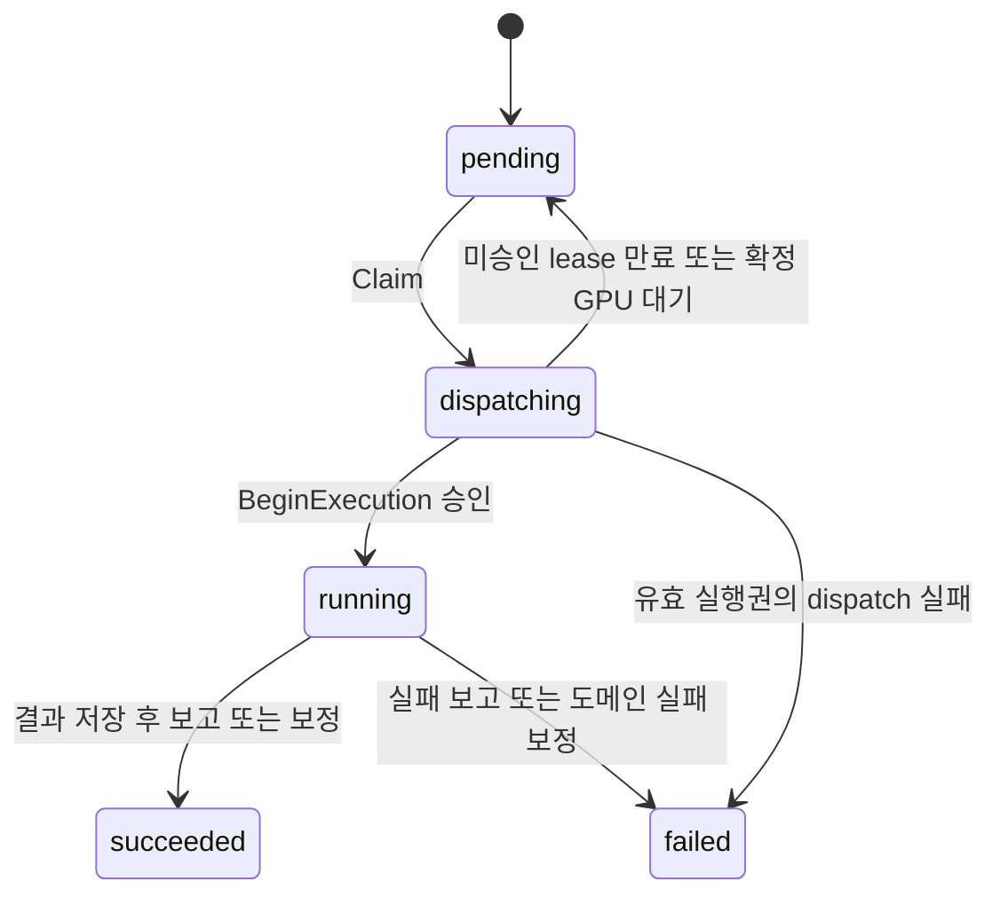

# 실행·전달·복구 계약

구현 위치는 [Operation](../../src/platform/model/operation/app), [Dispatcher](../../src/platform/model/dispatcher), [Reconciler](../../src/platform/model/reconciler), [Job 보고 클라이언트](../../src/platform/model/internal/operationreport/client.go)다.

## 저장과 전달

도메인의 [생성 전달 worker](request-creation.md)는 예약 ID로 `EnsureOperation`을 호출한다. 최초 생성은 `CreateOperation`과 같은 경로에서 `pending/queued` Operation과 Outbox 이벤트를 한 트랜잭션에 저장하며, 같은 ID·입력의 재전달은 기존 결과를 반환한다. Kafka 발행은 트랜잭션 밖에서 수행한다. Kafka가 일시 중단되어도 이미 저장한 이벤트를 발행 가능 상태로 유지한다.

Publisher의 실패 대기는 1, 2, 4, 8, 16, 32초 이후 최대 60초다. 발행 응답과 DB의 발행 완료 기록 사이에 장애가 나면 **동일 event_id**를 재발행할 수 있다. 전달 중복은 허용하며, DB Claim과 실행 승인이 실제 작업 시작을 제어한다.

Kafka command는 식별자, execution_type, generic resources를 전달한다. Claim 결과의 DB 값으로 routing과 resources를 다시 채운다. 모델 상세·학습 명세·HF token·dispatch token은 Kafka에 넣지 않는다.

Dispatcher는 Claim 실패, `dispatching` 중복, 불확실한 Docker 실행 결과를 처리 완료로 commit하지 않는다. 해당 오류로 소비 루프가 종료되고 Compose 재시작 정책으로 다시 시작한다. 확정 GPU 점유는 아래의 durable 대기 처리 뒤 commit하며 소비 루프를 계속한다. 이미 확인한 running/terminal 중복은 commit할 수 있다. offset commit 재시도 자체는 Job을 다시 실행하지 않는다.

## Claim과 시작 승인

| 값 | 의미 |
|---|---|
| dispatch_protocol | 신규 Operation은 1. 기존 행의 기본값 0은 legacy이며 pending 자동 실행은 거부 |
| dispatch_owner | Dispatcher 프로세스별 식별자 |
| dispatch_token | Claim마다 발급하는 실행권 식별자 |
| dispatch_generation | Claim마다 증가하는 실행권 세대. GPU 대기를 포함하므로 3을 넘을 수 있음 |
| gpu_wait_count | Docker 생성을 호출하지 않은 확정 GPU 대기 횟수. 같은 token의 재전송은 한 번만 계산 |
| gpu_wait_until | 다음 Claim 가능 시각. Outbox 재전달 예약 시각과 같은 DB 값 |
| dispatch_lease_until | Claim 시점부터 120초. DB row lock 이후 wall clock으로 만료 확인 |
| execution_instance_id | Job 프로세스를 시작할 때 만드는 UUID. 같은 프로세스의 RPC 재시도에서만 재사용 |
| execution_started_at | BeginExecution 승인 기록. 한 번 기록되면 자동 재할당하지 않음 |

Job은 도메인 명세를 처리하거나 GPU 작업을 시작하기 전에 `BeginExecution`을 호출한다. operation ID, token, resource ID, execution_type, process UUID가 일치해야 한다. 같은 프로세스의 응답 유실 재시도는 running 상태에서 멱등하게 처리하고, 새 프로세스가 같은 token으로 실행하려는 경우 거부한다.

Job의 phase·성공·실패 보고도 token과 process UUID를 검사한다. Dispatcher의 실패 보고는 현재 유효한 미시작 lease만 허용한다. Terminal 중복은 최초 결과·시각·오류 내용을 보존한다.

## GPU 대기

아래 대기는 단독 GPU 사용을 요청하는 학습 Job의 Dispatcher 경로다. 서빙 컨테이너는 다른 점유가 있어도 로딩을 시도하며 [서빙 계약](serving.md#같은-gpu의-여러-서빙-모델)을 따른다.

Dispatcher가 Docker 생성 호출 전 `gpuadmission.BusyError`를 받으면 내부 `DeferGPUDispatch`로 현재 token의 확정 대기를 보고한다. Operation은 row lock 아래 token 무효화, `pending/waiting_resources`·`GPU_BUSY`·대기 사유 저장, gpu_wait_count 증가, 동일 Outbox 이벤트의 20초 후 재발행을 한 트랜잭션으로 처리한다. 응답 유실 재전송은 카운트와 기한을 바꾸지 않으며 이후 실행 승인을 취소하지 않는다.

재전달 시각 전 Claim은 거절하고, Dispatcher는 이미 예약된 미래 이벤트가 있는 중복 레코드를 commit한다. 정상 GPU 점유 대기는 해당 Kafka partition의 다른 요청을 막거나 Dispatcher를 재시작하지 않는다. GPU가 계속 점유돼 있으면 같은 동작을 반복한다. 우선순위·선점·공정성 스케줄링은 없다. 로컬 학습의 대기·실행 중 취소는 [학습 제어](training-control.md)를 따른다.

## 학습 취소 fence

Training 내부 controller의 `RequestTrainingCancellation`은 원래 training_run·Operation을 확인하고 `cancelling`을 저장한다. retained dispatch token은 컨테이너·로그 식별에만 사용하며 BeginExecution·Job 보고를 더 이상 승인하지 않는다. Dispatcher는 이 상태의 중복 이벤트를 commit한다. Training이 공유 GPU 잠금 아래 생성 차단 기록과 실제 종료를 확인한 뒤 `ConfirmTrainingCancellation`으로 같은 세대를 `cancelled`로 확정한다. 일반 Reconciler가 취소를 성공/실패로 추측하거나 실행을 재개하지 않는다.

실제 미확인 생성의 한도는 **dispatch_generation − gpu_wait_count가 3회**다. GPU 대기만 한도에서 제외하며 generation·과거 실패를 초기화하지 않는다. Docker timeout·조회 실패 등은 GPU_BUSY로 바꾸지 않는다. RPC는 기존 내부 신뢰 경계의 Dispatcher 보고용이며 일반 학습 재시도 API가 아니다.

구버전의 확정 GPU_BUSY가 이미 한도를 소진한 경우에는 [명시적 복구 CLI](../testing/gpu-wait.md)를 사용한다. 동일 admission lock 아래 모든 generation의 Job과 생성 예약이 없음을 확인한 뒤 만료된 현재 token의 대기 한 번만 인정한다. 실행 승인·기존 Job·미확인 생성이 있는 요청은 거절한다.

## 복구 경계

Reconciler는 기본 15초 주기로 동작한다. 60초 이상 갱신되지 않은 active Operation 중 최근 30초 내 관찰하지 않은 대상을 조회한다.

- 승인 전 만료된 protocol 1 dispatch는 현재 token을 비교하고, token 무효화·pending 전환·원래 Outbox 재발행 예약을 한 트랜잭션으로 처리한다. compute `attempt`는 1을 유지하며 generation만 다음 Claim에서 증가한다.
- GPU 대기를 제외한 generation 3회를 소진하거나 근거가 부족하면 관찰 내용을 남긴다. 불확실한 생성을 무한 재시도하거나 terminal을 임의 변경하지 않는다. 이런 미해결 레코드는 Kafka partition 진행을 막을 수 있다.
- 도메인의 확정 완료·실패는 active Operation을 보정하는 근거다. Docker 관찰은 소유 label과 입력 식별자를 확인한다.
- protocol 1의 실행 승인이 없는 상태를 단순 Docker running 관찰로 running/terminal로 바꾸지 않는다.
- 상태 보정은 관찰 당시 status·attempt·updated_at을 비교하는 CAS로 Job의 동시 완료를 보호한다.
- 승인 이후 Job이 중단되어도 자동으로 재실행하지 않는다. 이 정책과 일반 학습 재시도 기능을 구분한다.

## Docker 실행 계약

Job 이름은 `model-op-<operation UUID>-<dispatch token UUID>`이고 소유·operation·execution_type·token label을 사용한다. 실행 이미지에는 `model-platform.execution-gate=1` label이 필요하다. 기존 Job 태그는 `launch-v1`이며, `deployment.serve`는 별도 `serving-v1` 태그와 `model-platform.deployment-serving=1` label도 확인한다.

현재 one-shot Job은 `--rm`이나 자동 restart 없이 실행한다. 완료·실패 컨테이너는 [Job GC](../operations/gc.md) 정책으로 보존·수집한다. [실제 장애 테스트](../testing/request-creation.md#dispatch-fault)는 승인 전 복구를, [제어 smoke](../testing/request-creation.md#control-smoke)는 전달과 관찰 보정을 확인한다.

`deployment.serve`는 승인된 CPU coordinator다. 실제 GPU 추론 컨테이너는 Deployment가 별도 소유한다. Reconciler는 해당 Deployment의 Operation ID와 apply_status를 확인하여 준비 완료를 보정한다. 런타임을 나중에 중지해도 준비 Operation succeeded는 유지한다. [서빙 계약](serving.md)을 참고한다.
