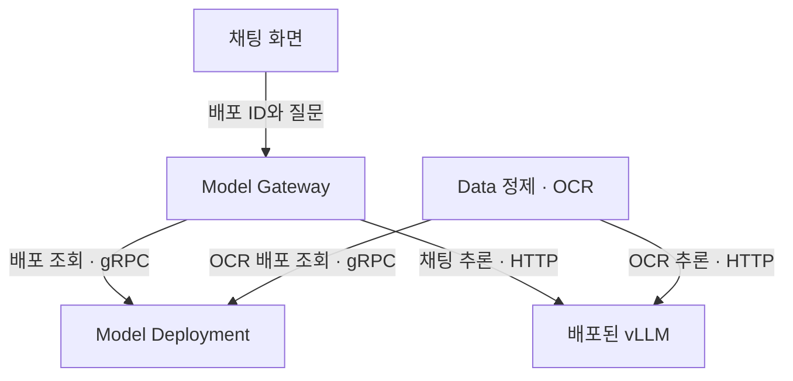

# LiteLLM 도입 검토와 모델 호출 경계

기록일: 2026-09-18. 갱신: 2026-10-12. 현재 소스에는 LiteLLM Proxy/자동 등록이 없다. 사용자가 Model 상용 API와 infra 확장을 요청해 [F7/F3a 단계](../plans/platform-expansion-work-plan-20261012.md)를 계획에 채택했다. 구체 SDK/Proxy 범위와 버전·제공자·예산은 해당 단계에서 정하고 실제 도입/호출 검증과 구분한다. 문서 QA 첫 인용 문제의 선행 조건으로 설치하지 않는다.

## 현재 판단

Model이 provider/model 신원·credential 참조·capability·local/external backend·사용량/한도와 정책을 소유한다. LiteLLM은 선택한 protocol/routing 구현이다. Agent/Knowledge/Data에 provider credential이나 별도 모델 상태 원본을 분산하지 않는다. 기존 배포/GPU lifecycle은 Model에 유지하고 embedding_space_id를 모르는 일반 alias로 기존 색인을 검색하지 않는다.

기존 embedding/rerank·색인과 Ops 관측/추적의 과거 인수는 [상태표](../status.md)를 따른다. n8n/Langfuse는 기존 구성을 재사용한다. 아래 등록/호환/오류 계약은 F7 구현 때 유지하고 새 provider backend 계약으로 보완한다.

## 1. 현재 프로젝트의 호출 방식

현재 소스에는 LiteLLM 자동 등록이나 Proxy 연동이 없다. Deployment 서비스가 배포 상태와 실행 식별 정보를 제공한다. 호스트 endpoint는 Docker 포트 바인딩을 관찰해 저장하며, 내부 endpoint는 배포 ID에 대응하는 컨테이너 이름으로 반환한다. 타 플랫폼이 Model DB를 직접 조회하지 않는다.

| 경로 | 배포 정보 조회 | 실제 추론 |
|---|---|---|
| 화면의 LLM 채팅 | Model Gateway가 Deployment의 GetDeployment 호출 | Gateway가 vLLM의 `/v1/chat/completions` 호출 |
| Data OCR | 정제 접수 시 Model의 ResolveDeployment 호출, 결과를 작업에 고정 | OCR Job이 선택된 vLLM에 HTTP 직접 호출 |
| 확인한 임베딩 smoke | 사용자가 배포 상세의 호스트 endpoint 확인 | 서버 Python이 vLLM `/v1/embeddings` 직접 호출 |
| Knowledge 임베딩 | K03 Model 계약과 K04의 기존 runtime 재사용 확인 | Model gRPC에 배포 ID로 요청하여 실제 48개 임베딩·색인 성공 |

`endpoint`의 `127.0.0.1:<포트>`는 배포 호스트에서 접근하는 주소다. `internal_endpoint`의 `model-serving-<배포ID>:8000`은 같은 Docker 네트워크에서 사용하는 이름이며 Docker DNS로 연결된다. 추론 JSON의 `model`에는 `served_model_name`을 사용한다. 배포 ID, 모델 버전 ID, 추론 모델 이름, 임베딩 공간 ID는 서로 다른 식별자다.

근거: [채팅 호출](../../src/platform/model/gateway/app/chat.go), [배포 정보](../../src/platform/model/deployment/app/serving.go), [OCR 조회](../../src/platform/data/internal/ocr/identity.go), [OCR 추론](../../src/platform/data/jobs/refinement/parse/ocr.py), [서빙 계약](serving.md).

## 2. 도입 대상과 이득

검토 대상은 별도 CPU 서비스로 실행하는 **LiteLLM Proxy**다. 모델 가중치를 다시 로드하는 GPU 추론 컨테이너를 추가하는 의미가 아니다. 기존 vLLM이 계속 추론한다. 등록 정보를 넣는 것에 더해 실제 요청을 Proxy로 보내야 정책·사용량·라우팅 기능을 얻는다.

| 이득 | 프로젝트에 적용하면 | 현재 단계에서의 가치 |
|---|---|---|
| 공통 API | 채팅·임베딩·rerank를 공통 진입점으로 연결 | 중간. vLLM의 호환 API와 기존 Gateway가 일부 역할을 수행 |
| 서비스별 접근과 제한 | Knowledge·Agent 등에 키를 나누고 허용 모델·호출량·예산 관리 | 여러 사용자·서비스에 제공할 때 큼 |
| 사용량 추적 | 어떤 서비스가 어떤 모델을 얼마나 호출했는지 집계 | 호출 주체 식별을 끝까지 전달할 때 유효 |
| 여러 배포의 라우팅 | 호환되는 복제 배포로 요청 분산, 정책에 따른 장애 대응 | 실제 복제 배포를 운영할 때 큼 |
| 외부 제공자 연결 | 로컬 vLLM과 외부 모델의 호출 경로 통합 | 외부 모델을 함께 사용할 때 큼 |

공식 문서는 vLLM 채팅·임베딩·rerank 연결, 키별 모델 접근·호출량 제한, 여러 배포의 라우팅·재시도를 제공한다. 실제 지원 범위는 도입할 LiteLLM과 프로젝트의 vLLM 버전을 고정한 뒤 확인한다. [vLLM 연결](https://docs.litellm.ai/docs/providers/vllm), [키 관리](https://docs.litellm.ai/docs/proxy/virtual_keys), [라우팅](https://docs.litellm.ai/docs/routing)

로컬 모델의 토큰 사용량과 실제 GPU 운영비는 다르다. 사용자 정의 단가를 설정할 수 있으나 GPU 점유 시간·전력·유휴 비용의 실측을 대신하지 않는다. 필요한 관리 기능의 제공 범위·Enterprise 조건도 구체 기능을 선택할 때 확인한다. [사용자 정의 단가](https://docs.litellm.ai/docs/proxy/custom_pricing), [Enterprise 범위](https://docs.litellm.ai/docs/enterprise)

## 3. 비용과 손해

아래는 현재 프로젝트에 적용했을 때의 설계 평가다. 지연·처리량·개발 기간을 실측한 결과가 아니다.

| 부담 | 추가로 다뤄야 할 상황 |
|---|---|
| 상태 동기화 | 모델 준비 성공·등록 실패, 모델 삭제 성공·경로 제거 실패, 오래된 등록 작업의 뒤늦은 도착 |
| 운영 구성 | Proxy 업데이트·상태 확인·등록 DB·키 관리. 다중 인스턴스에서 정책 상태 공유가 필요하면 Redis 등도 검토 |
| 공통 장애 지점 | GPU 서버가 정상이어도 Proxy 장애로 요청이 막힐 수 있음 |
| 추가 지연 | HTTP 전달·직렬화·정책 처리 비용. 짧은 임베딩 요청과 배치 요청 모두 측정 필요 |
| 기능 중복 | 기존 Gateway와 인증·라우팅·재시도·timeout을 각각 구현하면 원인 추적과 정책 관리가 복잡해짐 |
| 모델별 계약 유지 | 질문 접두사·pooling·정규화·입력 한도·rerank score·OCR 변환은 Model/Data/Knowledge의 계약으로 남음 |

동적 등록 API는 DB 저장 설정을 사용한다. 정적 config와 동적 등록을 동시에 관리 주체로 삼으면 같은 모델 정보가 서로 달라질 수 있다. Redis는 모든 단일 인스턴스 구성의 필수 요소는 아니며, 다중 인스턴스의 정책·라우팅 상태 공유 등 선택한 기능에 따라 요구된다. [모델 관리](https://docs.litellm.ai/docs/proxy/model_management), [Redis 필요 범위](https://docs.litellm.ai/docs/proxy/redis_requirements)

## 4. 도입할 경우의 소유권과 동기화 원칙

| 구성 | 소유할 책임 |
|---|---|
| Model Management·Deployment | 모델 파일·버전·배포·GPU·컨테이너와 실제 준비 상태의 기준 정보 |
| Model 내부 등록 동기화 | 준비된 배포의 등록, 중지·삭제 대상의 경로 제거, 재시도·재조정 |
| LiteLLM | 등록된 추론 경로로 요청 전달, 선택한 키·사용량·라우팅 정책 |
| Knowledge | 임베딩 결과 검증·색인·검색·선택적 rerank와 최종 순위 |
| Agent | MCP·Tool·Agent flow와 모델/검색 도구 사용 |

Model이 배포 정보를 소유하고 LiteLLM 등록은 그 정보를 반영한 호출 경로로 취급한다. 플랫폼 관리 대상 배포를 두 UI에서 독립적으로 수정하는 운영은 피한다. 외부 모델을 추가하면 외부 제공자 등록의 소유자도 별도로 정의한다.

도입 시 필요한 최소 동작은 다음과 같다.

1. 실제 모델 준비와 필요한 추론 capability 확인 후 등록 의도를 기록한다. 등록 API 실패로 이미 실행된 모델을 자동 삭제하지 않는다.
2. 배포 ID와 등록 ID를 연결하고 반복 요청·응답 유실·재시작을 처리한다. 기존 Operation/Outbox·재조정 패턴을 검토하되, 이번 문서에서는 새 실행 종류나 API를 확정하지 않는다.
3. 화면은 `runtime 준비 상태`와 `추론 경로 등록 상태`를 구분한다. 등록 실패를 모델 로딩 실패와 혼동하지 않는다.
4. 중지·삭제 시 신규 라우팅 차단과 진행 중 요청 처리 순서를 정한다. 주기적으로 실제 배포와 등록 상태를 비교해 누락·오래된 경로를 정리하고, 늦게 도착한 등록 요청이 중지된 배포를 다시 노출하지 않게 한다.
5. LiteLLM 등록 제거와 모델 컨테이너·캐시 삭제는 별개다. LiteLLM 경로 정리를 기존 Job GC나 Docker 삭제 기능과 혼동하지 않는다.
6. 호출 주체·요청 ID를 전달하고 재시도와 timeout의 소유자를 정한다. 현재 OCR 직접 호출을 Proxy로 전환할지는 별도 변경·검증으로 다룬다.

공식 관리 API에는 모델 등록·수정·삭제가 있으나, 이 프로젝트의 Docker 배포 상태와 자동 동기화하는 부분은 직접 연결해야 한다. [등록 API](https://docs.litellm.ai/docs/proxy/model_management)

## 5. Knowledge에서 유지할 호환성

임베딩은 배포 ID 또는 불변 profile로 대상을 지정한다. 같은 1,024차원이어도 다른 모델의 벡터 공간은 호환된다고 가정하지 않는다. 모델 artifact·tokenizer·질문/문서 전처리·pooling·정규화·차원을 포함하는 `embedding_space_id` 검증을 유지한다.

- 임베딩 부하 분산은 동일 공간을 제공하는 배포끼리만 허용한다. 변경 가능한 일반 별칭이 조용히 다른 공간을 가리키지 않게 한다.
- 다른 임베딩 모델로의 자동 fallback은 기본적으로 사용하지 않는다. 실제 사용한 profile과 실행 근거를 추적한다.
- Knowledge rerank는 기본 off이며, 요청된 rerank의 실패는 오류로 반환한다. 숨은 벡터 검색 fallback을 추가하지 않는다.
- Proxy가 지원한다고 해서 긴 입력을 조용히 자르거나 청크 내용·rerank score의 의미를 변경하지 않는다.
- 일반 runtime ready나 채팅 가능 표시만으로 embedding capability를 증명하지 않는다. K03에서 지원 원본/profile의 용도 표시와 검증 API를 추가하고 기존 배포의 서버 연동을 확인했다. 새로운 배포/profile은 해당 계약을 별도로 검증한다.

이 조건들은 [Knowledge 아키텍처](../knowledge-platform/architecture.md)의 기존 원칙이다. LiteLLM 사용 여부와 관계없이 유지한다.

## 6. 다음 행동

현재는 F0a 문서 QA 인용 누락을 해결한다. 이후 [확장 계획](../plans/platform-expansion-work-plan-20261012.md)의 F7a에서 backend/capability·provider identity·credential/한도·timeout/retry 소유자를 정하고 fake-provider 검사를 수행한다. F7b에서 선택한 한 provider chat을 실제 인수하고 F3a에서 필요한 LiteLLM SDK/Proxy/routing을 연결한다. 계정·키 참조·호출/전송 범위가 없는 live 호출은 실제 검증을 했다고 표시하지 않는다.

현재 모니터링·n8n이 미도입이라는 9월 검토 시점 안내는 최신 상태가 아니다. 현재 구성은 [인프라 검토](infrastructure-expansion-review.md), 환경/재개 위치는 [인수인계](../HANDOFF_NEXT_SESSION.md)를 따른다. 이 문서 변경은 서비스/Compose·runtime 설정·모델 경로를 변경하지 않는다.
