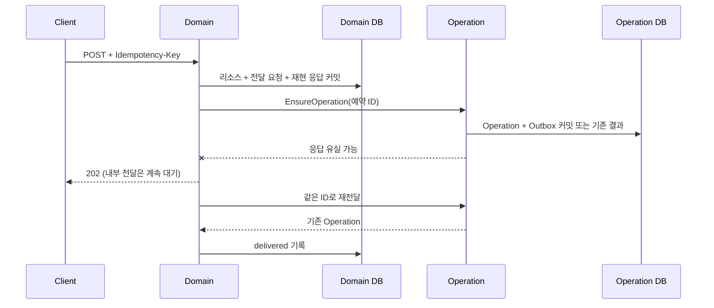

# 생성 요청의 멱등성과 Operation 전달

## API 계약

다음 POST는 선택적인 `Idempotency-Key` 헤더를 지원한다. 직접 gRPC 호출에서는 해당 요청의 `idempotency_key` 필드를 사용한다.

| POST 경로 | 범위 | 최초 / 재전송 응답 |
|---|---|---|
| `/api/models` | `model.create.v1` | 201, 같은 model_id와 최초 모델 표현 |
| `/api/models/:id/imports/huggingface` | `model.import.v1` | 202, 같은 model_version_id·operation_id·pending |
| `/api/training-runs` | `training.create.v1` | 202, 같은 training_run_id·operation_id·pending |
| `/api/deployments` | `deployment.create.v1` | 202, 같은 deployment_id·operation_id·pending |

키는 첫 글자가 영문·숫자인 1~128자 ASCII이며 이후 영문·숫자·`.`·`_`·`:`·`-`를 허용한다. REST 헤더는 정확히 한 값이어야 한다. 빈 값·중복 헤더·잘못된 형식은 400이다. 헤더를 생략하면 호출마다 새 요청으로 처리한다. 직접 gRPC의 빈 문자열도 생략으로 처리한다.

같은 범위·키와 같은 정규화 입력은 최초 성공 응답을 재현한다. 다른 유효 입력이면 409(`AlreadyExists`)다. JSON 속성 순서, 기존 명세의 기본값, UUID 표기, 정렬 가능한 GPU ID 순서는 정규화한다. 유효성 검증 실패는 기존 400/404/409 규칙을 따르며 키를 소비하지 않는다. DB 트랜잭션이 실패하면 키 예약도 rollback한다.

클라이언트는 요청을 보내기 **전에** 키와 입력을 보관한다. 응답 유실·5xx·timeout 후 재전송할 때 같은 키와 같은 입력을 유지한다. 새 키는 새 작업이다. 이미 완료·실패한 요청도 같은 키로 다시 실행되지 않는다. POST 재전송 응답의 `pending`은 최초 수락 응답이며 현재 실행 상태는 GET으로 확인한다.

현재 키 범위는 각 도메인 DB의 API 종류 단위다. import의 model_id도 입력 fingerprint에 포함되므로 같은 키를 다른 모델에 쓰면 충돌한다. 인증·tenant 분리가 없으며 도입 시 범위에 tenant를 포함해야 한다. 키 기록의 TTL·자동 정리는 아직 없고, 재현 보장은 DB 기록이 보존되는 동안 유지된다. 정규화 정책을 변경할 때 기존 키의 재현 호환성도 함께 다뤄야 한다.

## 두 개의 로컬 트랜잭션

도메인은 `api_requests`의 응답과 리소스, 예약된 Operation ID를 가진 `operation_submissions`를 **자기 DB의 한 트랜잭션**으로 저장한다. import credential도 같은 트랜잭션에 포함된다. 이 커밋이 끝나면 202로 요청 수락을 알릴 수 있다.

그 뒤 도메인의 전달 worker가 `EnsureOperation` gRPC를 호출한다. Operation은 정규화 생성 fingerprint를 비교하고 **Operation과 Outbox를 한 트랜잭션**으로 저장한다. 같은 ID·같은 입력이면 기존 Operation의 현재 상태를 반환하고 Outbox를 추가하지 않는다. 다른 입력이나 생성 fingerprint가 없는 legacy ID는 충돌로 거절한다.

도메인 저장 직후 최대 5초의 전달 시도를 하고, 내장 worker는 시작 시점부터 대기 행을 처리한다. 한 번에 최대 20개를 처리한 뒤 1초 대기한다. DB 잠금은 `FOR UPDATE SKIP LOCKED`, RPC 제한은 3초, 전달 트랜잭션은 5초다. 여러 프로세스가 같은 DB를 보더라도 잠긴 요청은 건너뛴다.

실패 간격은 1·2·4·8·16·32·60초이며 이후 최대 60초로 계속 재시도한다. 프로세스가 종료되거나 원격 커밋 뒤 로컬 ACK 저장이 실패해도 같은 ID로 복구한다. 클라이언트 응답이 끊겨도 이미 커밋된 전달 요청은 남는다.

## 조회와 오류 분류

모델 버전·학습·배포 GET 응답에 다음 필드가 추가된다. 기존 리소스와 학습 결과물처럼 생성 전달 행이 없는 경우에는 빈 문자열이다. 이전 고아 리소스를 추측해 자동으로 재실행하거나 backfill하지 않는다.

| 필드 / 값 | 의미 |
|---|---|
| `operation_id` | 도메인이 예약한 Operation ID |
| `submission_status=pending` | Operation 등록 ACK 대기; 응답 유실이면 실제 Operation은 이미 존재할 수 있음 |
| `submission_status=delivered` | 등록 ACK 확인; Job 성공 여부는 Operation 상태로 조회 |
| `submission_status=blocked` | 자동 재시도가 부적절한 오류; 원인 확인 필요 |
| `submission_error_code` | 마지막 gRPC 오류 코드; delivered이면 빈 문자열 |

202 직후 등록이 지연되면 `/api/operations/:id`는 404일 수 있다. 먼저 도메인 GET에서 `submission_status=delivered`를 기다린 다음 Operation을 조회한다. `blocked`를 작업 실패로 오해하거나 자동으로 새 키를 만들어 재요청하지 않는다.

`InvalidArgument`, `AlreadyExists`, `FailedPrecondition`, `PermissionDenied`, `Unauthenticated`는 blocked다. 그 외 통신·불확실한 오류는 재시도하며 `Unimplemented`도 여기에 포함한다. 오류 전문과 요청 본문은 전달 큐의 오류 필드에 저장하지 않는다. blocked는 원인 수정 후 운영자가 해당 요청의 실제 Operation 존재·생성 입력을 검토해야 하며, 이번 단계에는 범용 수동 재시도 API를 추가하지 않았다.

도메인의 `created`/`importing`을 RPC 오류만 보고 `failed`로 바꾸거나 credential을 지우지 않는다. 이 경로는 실패한 원격 호출을 취소했다고 가정하는 보상 대신, 이미 수락한 요청을 계속 전달하는 방식이다. Job의 BeginExecution·실행 후 자동 재시도 정책은 [기존 실행 프로토콜](execution-protocol.md)을 유지한다.

## HF credential

`api_requests`는 키의 SHA-256과 입력 fingerprint, 재현용 응답만 저장한다. import 입력 fingerprint는 기존 credential 암호화 키를 사용한 HMAC-SHA-256이며 token 변경도 충돌로 감지한다. 원문 token은 기존 1시간 TTL의 암호화 credential 테이블에만 저장한다. Operation 생성 요청·Kafka·로그·API 응답에는 넣지 않는다.

키 재전송은 credential을 다시 생성하거나 TTL을 연장하지 않는다. `import_credential_required` 표시는 만료 행 청소 뒤에도 남아, 필요한 token이 사라졌을 때 익명 import로 처리되는 일을 막는다. 시작 시 기존 credential이 남아 있는 버전에도 이 표시를 채운다. 이 패치 이전에 credential이 이미 삭제된 과거 버전은 원래 필요 여부를 복원할 수 없다.

장시간 전달 장애로 token이 만료되면 Job이 credential 조회에 실패할 수 있다. 같은 키로 실행을 다시 만들지 말고 기존 결과를 확인한 뒤 새 버전·새 키로 요청한다. 암호화 키는 서비스 재기동 간 유지한다. 키 회전은 기존 암호문과 HMAC 재현 둘에 영향을 주므로 별도 마이그레이션이 필요하다.

## 배포 호환성

추가 RPC `EnsureOperation`은 예약 ID가 필수다. 구버전 서버가 새 필드를 무시하고 임의 ID로 생성하는 일을 막기 위해 기존 `CreateOperation`으로 fallback하지 않는다. 구버전 서버에서는 `Unimplemented`로 대기하고 업그레이드 후 전달된다. `CreateOperation`의 기존 ID 생략 호출은 계속 지원한다.

**Operation → Management·Training·Deployment → Gateway** 순서로 전환한다. Gateway가 먼저 새 키를 받아도 구버전 도메인은 키를 무시할 수 있으므로, 전체 전환 전에는 새 헤더의 재현을 기대하면 안 된다. DB 변경과 protobuf 필드는 추가 방식이고 기존 Job과 실행 승인 RPC는 유지한다. [검증·전환 절차](../testing/request-creation.md)를 따른다.

트랜잭션 경합과 잠금의 근거는 [PostgreSQL INSERT](https://www.postgresql.org/docs/current/sql-insert.html), [SELECT의 SKIP LOCKED](https://www.postgresql.org/docs/current/sql-select.html), 오류 분류는 [gRPC 상태 코드](https://grpc.io/docs/guides/status-codes/)를 참고한다.
